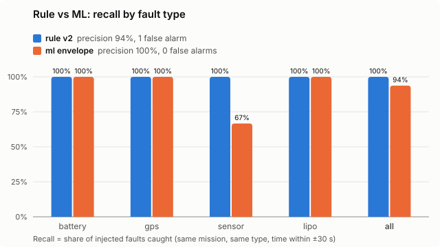

# OpenClaw Drone Analytics

ระบบ monitoring และ fault analytics สำหรับฝูงโดรน โดยใช้ข้อมูลจำลอง (synthetic)
จุดขายหลัก: แยก **เฉลย** (`injected_anomalies` = ความผิดปกติที่ฉีดเข้าไปเอง) ออกจาก
**สิ่งที่ระบบตรวจเจอ** (`alerts`) เพื่อวัด precision/recall ของตัวตรวจจับได้จริง

## สถานะ

| เฟส | งาน | สถานะ |
|---|---|---|
| 3 | Simulator + ฉีด anomaly 4 แบบ | เสร็จ |
| 4 | Ingestion API (FastAPI + Pydantic) + SQLite | เสร็จ |
| 5 | Analytics: rule-based + ML (Isolation Forest + envelope) + precision/recall | เสร็จ |
| 6 | Dashboard (Streamlit, read-only) | เสร็จ |
| 7–9 | OpenClaw agent (read-only), Docker + CI, writeup | วางแผน |

## โครงสร้าง

```
openclaw-drone-analytics/
├── src/
│   ├── simulator/           # สร้างข้อมูลจำลอง 3 ลำ + สภาพรบกวน (ลม, multipath) + ฉีด anomaly
│   ├── api/                 # เฟส 4: FastAPI รับ telemetry เป็นชุด
│   │   ├── models.py            # สัญญาข้อมูล (Pydantic): กฎตรวจแต่ละคอลัมน์
│   │   └── main.py              # POST /telemetry/batch, GET /health
│   ├── db/                  # เฟส 4: SQLite
│   │   ├── schema.sql           # 5 ตาราง (drones, missions, telemetry_logs, injected_anomalies, alerts)
│   │   ├── database.py          # เชื่อมต่อ + เปิด foreign keys ทุกครั้ง
│   │   └── repository.py        # เขียน telemetry: ตรวจ mission + นับข้อมูลซ้ำ
│   ├── ingest/              # เฟส 4: สคริปต์โหลดข้อมูล
│   │   ├── load_reference.py    # drones + missions
│   │   ├── load_ground_truth.py # เฉลย (แยกจาก API โดยตั้งใจ)
│   │   └── send_telemetry.py    # ส่ง CSV ผ่าน API เป็นชุด
│   ├── analytics/           # เฟส 5: ตัวตรวจจับ (ห้ามอ่านเฉลย มี test คุม)
│   │   ├── fleet_health.py      # สรุปสุขภาพฝูง (SQL window functions)
│   │   ├── rule_detector.py     # กฎที่ดูรูปร่างสัญญาณ
│   │   └── ml_detector.py       # เรียนจากเที่ยวบินปกติ: Isolation Forest + envelope
│   ├── dashboard/           # เฟส 6: Streamlit อ่านอย่างเดียว
│   │   ├── queries.py           # SQL รวมข้อมูลก่อนส่งให้หน้าเว็บ
│   │   ├── views.py             # 5 หน้า: overview, missions, alerts, energy, evaluation
│   │   └── app.py               # จุดเริ่ม: streamlit run src/dashboard/app.py
│   └── evaluation/          # เฟส 5: ส่วนเดียวที่อ่านเฉลยได้
│       ├── evaluator.py         # precision / recall / false alarm ต่อชั่วโมง
│       ├── sweep.py             # กวาด threshold บนชุด dev
│       └── compare.py           # rule vs ML บนข้อมูลชุดเดียวกัน + กราฟ SVG
├── tests/                   # pytest: API, ฐานข้อมูล, simulator, ตัวตรวจจับ, evaluator
├── docs/                    # กราฟผลลัพธ์ (SVG)
├── models/                  # โมเดลที่ฝึกแล้ว (สร้างตอนรัน ไม่เข้า git)
└── data/                    # CSV + drone.db (สร้างตอนรัน ไม่เข้า git)
```

## ติดตั้ง (ครั้งแรก)

ต้องมี Python 3.10 ขึ้นไป บน Ubuntu ต้องมีแพ็กเกจ venv ด้วย (`sudo apt install python3.10-venv`)

```bash
git clone git@github.com:ChatKh/openclaw-drone-analytics.git
cd openclaw-drone-analytics
python3 -m venv .venv
source .venv/bin/activate
pip install -r requirements.txt
python -m pytest -q
```

## รันทั้งเส้น: สร้างข้อมูล → เก็บลงฐานข้อมูล

```bash
source .venv/bin/activate

# 1) สร้างข้อมูลจำลอง (CSV 4 ไฟล์ใน data/)
python -m src.simulator.run                                    # ชุด dev: seed 42, 15 วัน
python -m src.simulator.run --seed 7 --days 30 --out data/test  # ชุด test: เก็บไว้วัดผลรอบสุดท้าย

# 2) โหลดข้อมูลอ้างอิง แล้วโหลดเฉลย
python -m src.ingest.load_reference
python -m src.ingest.load_ground_truth

# 3) เปิด server (terminal ที่ 1)
uvicorn src.api.main:app

# 4) ส่ง telemetry ผ่าน API (terminal ที่ 2)
python -m src.ingest.send_telemetry
```

ผลที่คาด: `sent=162360 accepted=162360 duplicates=0 rejected=0 (33 batches)`
ส่งซ้ำได้อย่างปลอดภัย รอบสองจะได้ `accepted=0 duplicates=162360`

หน้าทดลอง API: http://127.0.0.1:8000/docs
ฐานข้อมูลอยู่ที่ `data/drone.db` (เปลี่ยนได้ด้วยตัวแปร `DRONE_DB_PATH`)

## ตรวจจับและวัดผล (เฟส 5)

```bash
python -m src.analytics.rule_detector                 # เขียน alerts (detector='rule')
python -m src.analytics.ml_detector train             # ฝึกบนเที่ยวบินปกติ 100 เที่ยว + ตั้ง threshold บนอีก 100 เที่ยว (~40 s)
python -m src.analytics.ml_detector detect            # เขียน alerts (detector='ml')
python -m src.evaluation.evaluator --detector rule    # เทียบกับเฉลย
python -m src.evaluation.compare --svg docs/rule_vs_ml.svg   # rule vs ML ทุกโหมด
```

## Dashboard (เฟส 6)

```bash
streamlit run src/dashboard/app.py      # เปิด http://localhost:8501
```

| หน้า | แสดงอะไร |
|---|---|
| Overview | จำนวนเที่ยวบิน ชั่วโมงบิน สุขภาพต่อลำ และ alert ต่อลำแยกตาม detector |
| Missions | telemetry ของแต่ละเที่ยว (ความสูง แบต hdop) พร้อมแถบ alert ของ rule และ ML ซ้อนกัน |
| Alerts | alert ทั้งหมด กรองได้ และบอกว่า detector อีกตัวเห็นด้วยไหม (ไม่ใช้เฉลย) |
| Energy | แบตที่ใช้ต่อช่วงบิน: VTOL ใช้ ~80% ในเวลาแค่ 2 นาที (ขึ้นและลง) |
| Evaluation | precision / recall ต่อ detector (หน้าเดียวที่อ่านเฉลย และบอกไว้บนหน้า) |

- **อ่านอย่างเดียว** เปิด SQLite แบบ `mode=ro` ถ้าโค้ดผิดก็เขียนทับข้อมูลไม่ได้ (มี test คุม)
- **รวมข้อมูลใน SQL ก่อนแสดง** 163k แถวไม่ถูกส่งไปที่ browser กราฟหนึ่งเที่ยวใช้ 540 จุด (จุดละ 10 วินาที)
  ความสูงใช้ค่า MAX ของแต่ละช่วง spike 1 วินาทีจึงยังเห็นในกราฟ
- **ไม่มีข้อมูลก็ไม่ crash** ไม่มีไฟล์ฐานข้อมูล หรือยังไม่มี telemetry จะขึ้นวิธีสร้างข้อมูลแทน
- เลือกชุด dev หรือ test ได้ที่แถบซ้าย

## ผลลัพธ์บนชุด test (seed 7, 30 วัน, 16 anomalies, 90 ชั่วโมงบิน)

ทุกค่าตั้งถูกเลือกบนชุด dev หรือบนเที่ยวบินปกติก่อน แล้ววัดบนชุด test ครั้งเดียว



| ตัวตรวจจับ | precision | recall | false alarm | ต่อชั่วโมงบิน |
|---|---|---|---|---|
| rule v2 | 94% | 100% | 1 (ลมแรงสุด) | 0.01 |
| ML: Isolation Forest อย่างเดียว | 0% | 0% | 4 | 0.04 |
| ML: envelope (ค่าเริ่มต้น) | 100% | 94% | 0 | 0.00 |
| ML: hybrid (forest + envelope) | 79% | 94% | 4 | 0.04 |

สิ่งที่เรียนรู้
- **Isolation Forest อย่างเดียวจับไม่ได้เลย** คะแนนของมันอิ่มตัวเมื่อค่าหลุดช่วงที่เคยเห็น:
  altitude spike 23 m ได้คะแนน 0.60 ขณะที่หน้าต่างลมกระโชกปกติได้ 0.75+ จึงเพิ่ม envelope
  (ช่วงปกติของแต่ละ feature ที่เรียนจากเที่ยวบินปกติ) ซึ่งวัดได้ว่า "หลุดไกลแค่ไหน"
- **rule กับ ML พลาดคนละที่** rule จับ spike เล็กได้ (ML พลาด spike 25.6 m) แต่ ML ไม่เตือนผิดในลมแรงสุด
  การรวมสองตัวต้องทดสอบบนข้อมูลชุดใหม่ ไม่ใช่ปรับบนชุด test นี้
- ตัวเลขมาจากข้อมูลจำลอง 16 anomalies: ความต่าง 1 ตัวคือ 6% จึงบอกทิศทาง ไม่ใช่ความแม่นยำจริงในสนาม

## หลักการออกแบบที่สำคัญ

- **schema คือสัญญา** แหล่งข้อมูลเปลี่ยนได้ (simulator วันนี้, ArduPilot SITL ทีหลัง) โดย pipeline ไม่ต้องแก้
- **ingestion ตรวจรูปแบบ ไม่ตรวจความผิดปกติ** ค่าที่ถูกฉีด (เช่น ความสูง 45 m) ยังเป็นข้อมูลที่ถูกต้อง การตรวจจับเป็นงานเฟส 5
- **แถวเสียแถวเดียวไม่ทำให้ทั้งชุดล้ม** แถวดีถูกเก็บ แถวเสียถูกส่งคืนพร้อมเหตุผล
- **ข้อสอบมีทั้งง่ายและก้ำกึ่ง** ความแรงของ anomaly ถูกสุ่มให้คร่อม threshold ตรวจจับ บางตัวจึงจับยากโดยตั้งใจ ค่าที่ฉีดจริงถูกบันทึกใน `params`
- **มีสภาพรบกวนที่ปกติแต่ดูผิดปกติ** ลมกระโชก (~35% ของเที่ยวบิน: ความสูงแกว่ง, แบตวูบชั่วคราวแล้วกลับ, VTOL หมดเร็วขึ้น) และ GPS multipath ใต้ทรงพุ่ม (~30%: hdop สูงขึ้นช่วงสั้นๆ) ไม่อยู่ในเฉลย ตัวตรวจจับที่ดีต้องไม่เตือนเพราะสิ่งเหล่านี้ บันทึกไว้ใน `conditions.csv` เพื่อวิเคราะห์ผลเท่านั้น
- **ปรับบนชุด dev วัดผลบนชุด test** ชุด test (seed อื่น) ไม่ถูกดูระหว่างปรับ threshold เพื่อไม่ให้ตัวเลขดีเกินจริง
- **ML เรียนจากเที่ยวบินปกติเท่านั้น** ไม่เคยเห็น fault และ threshold ตั้งจากเที่ยวบินปกติอีกชุด (ยอมให้เตือนผิด ≤1% ของเที่ยวบิน) ไม่ได้ใช้เฉลย
- **ตัวตรวจจับมองไม่เห็นเฉลย** เฉลยโหลดด้วยสคริปต์แยก และตาราง missions ไม่มีคอลัมน์ที่บอกว่าภารกิจไหนโดนฉีด
